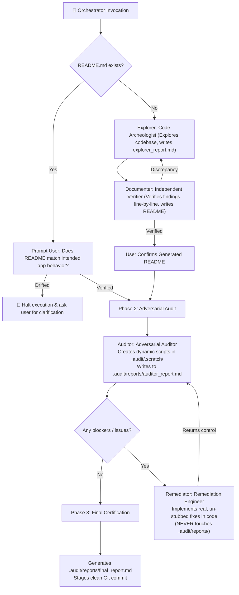

# 🚀 repo-push

[](https://github.com/subhasishsaha/repo-push-skill/actions)
[](LICENSE)

**`repo-push`** is an orchestrator-driven multi-agent verification protocol and developer toolkit designed to audit, sanitize, package, and standardize codebases before pushing or publishing to **GitHub, GitLab, Bitbucket**, or other remote Git hosting platforms.

The primary coordinator acts as the **Orchestrator**, actively spawning and managing dedicated subagents (`explorer`, `documenter`, `auditor`, `remediator`).

---

## 📦 Installation & Setup

`repo-push` can be installed either as an **agent skill** or as an **Antigravity plugin**:

### Option 1: Global Skill Installation (Universal)
Clone the repository and ask your AI agent to install it into your global skills directory:
```bash
git clone https://github.com/subhasishsaha/repo-push-skill.git
```
Then prompt your agent:
> *"Install this skill in my global skills directory."*

Your agent will automatically copy `skills/repo-push/` to your environment's global skills path:
- **Antigravity / Gemini CLI:** `~/.gemini/config/skills/repo-push/`
- **Claude Code:** `~/.claude/skills/repo-push/`
- **Cursor / Windsurf / Copilot:** `.cursor/skills/repo-push/` or reference `skills/repo-push/SKILL.md` in `.cursorrules` / `.windsurfrules`

### Option 2: Antigravity Plugin Installation
`repo-push` includes a canonical `plugin.json` manifest. You can install it as an integrated plugin:
```bash
antigravity plugin install https://github.com/subhasishsaha/repo-push-skill.git
```
Or open the cloned folder in Antigravity IDE—it automatically detects `plugin.json` and loads all associated skills, schemas, and configurations.

---

## 🚀 Quick Start & Usage

Navigate to any codebase you want to prepare for remote publishing:

1. **Trigger via Slash Command:**
   ```text
   /repo-push
   ```
2. **Or ask your coding agent in natural language:**
   > *"Run repo-push on this repository to audit, sanitize, and prepare it for remote publishing."*
   > *"Perform an adversarial pre-push review on this codebase."*

3. **Autonomous Verification & Remote Publishing Workflow:**
   - **Step 0 (Remote Auto-Discovery & Config):** If `.repo-push/config.yaml` is missing, `repo-push` inspects your existing `git remote -v`, maps platforms (GitHub, GitLab, Hugging Face, Bitbucket), and drafts `.repo-push/config.yaml` with canonical mutual exclusion rules for explicit user verification before any publishing operation.
   - **Phase 1 (README Gate):** The Orchestrator verifies your `README.md` against intended functionality and prompts for confirmation. (If missing, `explorer` and `documenter` collaborate to draft one).
   - **Phase 2 (Adversarial Loop & Targeted Scaffolding):** The agent only scaffolds CI/workflows for declared target platforms (e.g. only `.github/workflows/` for GitHub; never unwanted `.gitlab-ci.yml`). If `.repo-push/actions.yaml` is present, it compiles declarative action intents into native platform workflows. The `auditor` executes on-demand inspection scripts in `.audit/.scratch/` or runs the canonical `audit_runner.py`. The `remediator` fixes all issues in application code.
   - **Phase 3 (Certification & Filtered Remote Push):** Upon passing all 6 verification gates (`GATE_1` through `GATE_6`), the agent runs a pre-push dry-run, prompts for explicit confirmation (`Ready to push? [Yes / No]`), and publishes using isolated Git worktrees with persistent kernel-level OS file locking (`fcntl.flock` / `msvcrt.locking`) and platform exclusion filtering.

---

## 📋 Configuration Standard: `.repo-push/`

`repo-push` keeps your root clean by managing configurations inside `.repo-push/`:

```text
.repo-push/
├── config.yaml       # (Required) Target remotes, platform exclusions, pre-push controls
└── actions.yaml      # (Optional) Declarative workflow & action intents across platforms
```

### 1. Remote Publishing: `.repo-push/config.yaml`

```yaml
# yaml-language-server: $schema=https://raw.githubusercontent.com/subhasishsaha/repo-push-skill/main/schemas/repo-push.schema.json
version: "1.0"
require_confirmation: true

pre_push:
  require_all_gates: true      # Require all 6 gates to achieve PASS status
  dry_run: true                # Run git push --dry-run first

targets:
  - name: origin
    platform: github           # github | gitlab | huggingface | bitbucket | generic
    url: https://github.com/username/project.git
    branch: main
    push_tags: true
    exclude:                   # Never send platform clutter across remotes
      - .gitlab-ci.yml
      - bitbucket-pipelines.yml

  - name: hf-demo
    platform: huggingface
    url: https://huggingface.co/spaces/username/project-demo
    branch: main
    exclude:
      - .github/
      - .gitlab-ci.yml
      - tests/
    metadata:
      title: "Project Demo"
      sdk: "gradio"            # gradio | streamlit | docker | static
      app_file: "app.py"
    lfs_patterns:
      - "*.safetensors"
      - "*.bin"
```

### 2. Custom Action Recipes: `.repo-push/actions.yaml` (Optional)

Instead of hand-writing complex GitHub Actions or GitLab CI YAML, describe your workflows in plain English. The agent compiles them into native, production-grade workflows for all designated platforms (`platforms: all` or specific platforms):

```yaml
# yaml-language-server: $schema=https://raw.githubusercontent.com/subhasishsaha/repo-push-skill/main/schemas/repo-push-actions.schema.json
version: "1.0"

actions:
  # Shared workflow compiled across ALL active targets in config.yaml
  - name: test
    platforms: all
    description: "Run pytest across Python 3.10 and 3.11 with coverage on push and PR"

  - name: lint
    platforms: all
    description: "Check formatting and code quality using ruff"

  # Platform-specific workflow (only compiled for GitHub)
  - name: release
    platforms: [github]
    description: "Publish a GitHub release with automated release notes when a tag starting with 'v' is pushed"
```

- **Deterministic Remote Setup:** When you already have configured remotes, `repo-push` generates `config.yaml` deterministically from `git remote -v`, resolving active branches and targets for user verification before publishing.
- **Strict Cross-Validation (`ACT-001`):** Prevents dead code by ensuring every platform referenced in `actions.yaml` is actively defined in `config.yaml`.
- **Isolated Worktree Publishing:** Publishing does not switch the user's active branch or modify application source files. Temporary worktree files and Git worktree metadata are managed separately under `.audit/.scratch/worktrees/` with structured `try ... finally` cleanup (with visible warnings if manual cleanup is needed after unexpected process aborts).
- **Persistent Kernel-Level OS File Locking:** Uses `msvcrt.locking` on Windows and `fcntl.flock` on Unix on `.audit/.trusted/publishing.lock`. The lock file is permanently retained on disk (never deleted on normal release), completely eliminating check-then-delete and recreation races between concurrent publishing processes.
- **Fail-Closed Remote URL Verification:** Publishing resolves the target remote's expected URL from `.repo-push/config.yaml` (or explicit `--expected-url`) and verifies that all configured push URLs match. Fails closed if configuration is missing, malformed, or missing the target/URL. Transparently normalizes Git URLs (with or without `.git` or trailing slashes).
- **Two Distinct Publishing Modes:**
  - `history_preserving` (default): Publishes a new release commit with exclusions applied, while retaining full prior commit ancestry.
  - `clean_snapshot`: Publishes a single orphan commit with zero prior ancestry. Forbids `--tags` upfront to prevent leaking excluded files or history through existing Git tags.

---

## 🛡️ Defense-in-Depth Behavioral Isolation Model

To prevent subagents from overstepping their scope—such as a prompt-injected **`remediator` modifying `auditor`'s report** instead of fixing application code—`repo-push` enforces a **3-Layer Defense-in-Depth Model**:

1. **Layer 1 (Prompt Contracts & Untrusted Data Defense):** Explicit in-memory scope boundaries and permission contracts injected into each subagent's system prompt (with zero `.audit/.agents/` disk clutter). All repository files are treated as untrusted data to defend against prompt injection.
2. **Layer 2 (OS Read-Only Permission Barrier):** `.audit/reports/` and `.audit/.trusted/` are marked read-only using filesystem attributes (`attrib +r` on Windows, `chmod -R 555` on Unix) prior to dispatching `remediator`.
3. **Layer 3 (HMAC Tamper Detection & Verified Rollback):** A cryptographic manifest authenticated via HMAC-SHA256 is recorded prior to remediation. The ephemeral 256-bit session secret key is stored outside the repository in verified private per-user directories (`0700` permissions on POSIX, verified via `lstat` to reject symlinks, unowned files, and permissive modes). Session keys are managed across deterministic candidate paths (primary path and stable `.fallback_keys/` directory) with atomic non-overwriting publication and `os.O_BINARY` creation. If tampering or unauthorized modifications are detected, the turn fails closed (`exit code 1`). Before restoring reports, the local backup directory is independently verified against the authenticated manifest.

> [!NOTE]
> **Operational Boundary:** Within an agent execution environment sharing the same OS user account and filesystem, filesystem permission attributes and HMAC signatures provide tamper-detection and guardrails against accidental modifications, model drift, and unprivileged overwrites. They do not constitute an impenetrable security boundary against malicious code execution running under the same user account.

- **`explorer`**: Permitted writes: `.audit/reports/explorer_report.md` & `.audit/.scratch/`. Forbidden: `README.md`, application code.
- **`documenter`**: Permitted writes: `README.md`. Forbidden: `.audit/reports/`, application code.
- **`auditor`**: Permitted writes: `.audit/.scratch/`, `.audit/reports/auditor_report.md`, and `.audit/reports/audit_evidence.json`. Forbidden: ANY application code or `README.md`.
- **`remediator`**: Permitted writes: Application code & configs. **CRITICAL RESTRICTION: Forbidden from modifying `.audit/reports/` or `.audit/.trusted/` (protected by OS read-only attributes, HMAC tamper detection, and verified manifest rollback).**

---

## 🏗️ The 3-Phase, 4-Agent Architecture



---

## 🛠️ Canonical Verification Gates & Dynamic Scripting

Verification is executed via the canonical engine (`skills/repo-push/scripts/audit_runner.py`), augmented by on-demand targeted inspection scripts created by the `auditor` in `.audit/.scratch/`. All code analysis uses **static AST parsing (`ast.parse()`) exclusively**—untrusted application code is never executed:

1. **Gate 1: Repository Hygiene:** Enforces clean Git working tree (fails closed on uncommitted or unexpected untracked modifications), validates `README.md` presence, LICENSE presence, and `.gitignore` completeness.
2. **Gate 2: AST Code Integrity:** AST inspection distinguishing abstract interfaces (`@abstractmethod`, `abc.ABC`, `typing.Protocol`) from incomplete concrete stubs (`pass`, `...`, `raise NotImplementedError`, and `// TODO` markers).
3. **Gate 3: Static Dependency Consistency Analysis:** Verifies static source code imports against declared manifests for Python (`requirements.txt`, `pyproject.toml`) and Node.js (`package.json`) with canonical alias resolution (`KNOWN_MODULE_MAP`). Fails closed on syntax and AST parsing errors.
4. **Gate 4: Secrets & Commit History:** Scans tracked files, untracked files outside standard ignores, and locally available reachable Git history (`git log --all -p`) for API keys and credentials. Restricts fixture exemptions strictly to `EXACT_TEST_FIXTURE_TOKENS` with zero substring-based (`dummy`, `example`, `placeholder`), low-entropy, comment-based (`# test-fixture`, `# noqa`), or line-skipping bypasses. Masks tokens (`ghp_****`) in reports and provides fail-safe `NOT_VERIFIED` status reporting.
5. **Gate 5: Configuration Validation:** Validates `.repo-push/config.yaml` against its JSON Schema with target name uniqueness, Git URL regexes, and path traversal rejection. Fails closed if dependencies or schema files are missing.
6. **Gate 6: Actions Cross-Validation:** Enforces that every platform referenced in `actions.yaml` is actively defined in `config.yaml` (`ACT-001`).

The `.audit/` directory is excluded in `.gitignore` so temporary audit scripts never pollute the repository.

---

## 📂 Repository Structure

```text
├── plugin.json                                # Plugin manifest for Antigravity & Agent ecosystems
├── README.md                                  # Repository overview and documentation
├── LICENSE                                    # Apache-2.0 license
├── .gitignore                                 # Clean gitignore configuration
├── .editorconfig                              # Standardized editor config
├── .github/
│   ├── workflows/ci.yml                       # Multi-version CI test & audit pipeline
│   └── dependabot.yml                         # Automated dependency alerts
│
├── .repo-push/                                # Active repository publishing config
│   ├── config.yaml                            # Remote targets, platform exclusions, pre-push gates
│   └── actions.yaml                           # (Optional) Declarative workflow & action intents
│
├── schemas/                                   # Public JSON Schemas for IDE autocomplete
│   ├── repo-push.schema.json                  # Schema for config.yaml
│   └── repo-push-actions.schema.json          # Schema for actions.yaml
│
├── tests/                                     # Automated test suite (46 unit & integration tests across 6 modules)
│   ├── test_isolation.py                      # Fail-closed behavioral isolation & HMAC tests
│   ├── test_config_validator.py               # Schema, duplicate target, and path traversal tests
│   ├── test_config_generator.py               # Deterministic config generator tests
│   ├── test_schema_validation.py              # JSON Schema syntax tests
│   ├── test_git_publishing.py                 # Isolated worktree publishing & persistent lock tests
│   └── test_audit_runner.py                   # 6-Gate verification & AST/secret masking tests
│
├── skills/
│   └── repo-push/
│       ├── SKILL.md                           # Master multi-agent orchestrator runbook
│       │
│       ├── scripts/                           # Production-grade verification & publishing tooling
│       │   ├── generate_config.py             # Deterministic remote & platform discovery
│       │   ├── validate_config.py             # PyYAML & JSON Schema validator & cross-referencer
│       │   ├── enforce_isolation.py           # Fail-closed OS file locking, persistent HMAC authentication & rollback
│       │   ├── git_publisher.py               # Isolated Git worktree publisher with persistent kernel-level OS file locking
│       │   └── audit_runner.py                # 6-Gate canonical evidence-based verification engine
│       │
│       ├── schemas/                           # Bundled JSON schemas
│       │   ├── repo-push.schema.json
│       │   └── repo-push-actions.schema.json
│       │
│       ├── templates/                         # Production-grade templates
│       │   ├── repo-push/                     # Starter config.yaml & actions.yaml
│       │   ├── agents/                        # Subagent boundary specifications
│       │   ├── audit/                         # auditor_report & final_report gate templates
│       │   ├── gitignore/                     # Node, Python, Go, Rust, Universal
│       │   ├── docs/                          # README, CONTRIBUTING, SECURITY, EditorConfig
│       │   ├── github/                        # Workflows, Issue & PR templates, Dependabot
│       │   ├── gitlab/                        # .gitlab-ci.yml
│       │   └── bitbucket/                     # bitbucket-pipelines.yml
│       │
│       └── references/                        # Deep runbooks & guides
│           ├── readiness_checklist.md         # 50-point pre-flight checklist
│           ├── secrets_remediation.md         # Git history scrubbing (git-filter-repo)
│           ├── license_selection_guide.md     # SPDX license decision tree
│           └── platform_feature_matrix.md     # Multi-platform feature mapping
```

---

## 🌐 Universal Harness & Agent Agnosticism

This skill operates seamlessly across any agent harness:

| Harness / Agent | Configuration Method | Location |
| :--- | :--- | :--- |
| **Claude Code** | Native skill directory | `.claude/skills/repo-push/` or `skills/repo-push/` |
| **Cursor** | Context rules | Include reference in `.cursorrules` or `.cursor/skills/` |
| **Windsurf** | Project rule | Mention skill workflow in `.windsurfrules` |
| **GitHub Copilot** | Repository instructions | Reference in `.github/copilot-instructions.md` |
| **Antigravity / Gemini** | Plugin or workspace skill | Mount `plugin.json` or place in `.agents/skills/` |
| **Cline / Roo Code** | Custom instructions | Point to `skills/repo-push/SKILL.md` in custom instructions |
| **Aider** | Command / instructions | Pass `skills/repo-push/SKILL.md` to `/read` or `.aider.conf.yml` |
| **Custom Agent / Swarms** | System prompt / Tool calling | Point LLM to `SKILL.md` and equip standard shell & file tools |

---

## 📄 License

Licensed under the [Apache License, Version 2.0](LICENSE).
