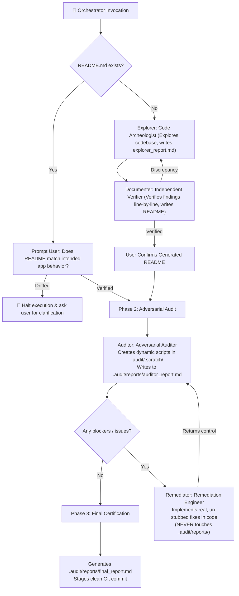

# 🚀 repo-push

[](https://github.com/subhasishsaha/repo-push-skill/actions)
[](LICENSE)

**`repo-push`** is an orchestrator-driven multi-agent verification protocol and developer toolkit designed to audit, sanitize, package, and standardize codebases before pushing or publishing to **GitHub, GitLab, Bitbucket**, or other remote Git hosting platforms.

The primary coordinator acts as the **Orchestrator**, actively spawning and managing dedicated subagents (`explorer`, `documenter`, `auditor`, `remediator`).

---

## 📦 Installation & Setup

Installing `repo-push` into your AI agent is simple:

1. **Clone the repository:**
   ```bash
   git clone https://github.com/subhasishsaha/repo-push-skill.git
   ```

2. **Open the repository in your AI agent** (Antigravity, Claude Code, Cursor, Windsurf, etc.).

3. **Ask your agent to install it globally:**
   > *"Install this skill in my global skills directory."*

Your agent will automatically detect your environment, copy `skills/repo-push` to your global configuration (e.g. `~/.gemini/config/skills/repo-push/` or `~/.claude/skills/repo-push/`), and make it available across all your projects.

---

## 🚀 Quick Start & Usage

Navigate to any codebase you want to prepare for remote publishing:

1. **Trigger via Slash Command:**
   ```text
   /repo-push
   ```
2. **Or ask your coding agent in natural language:**
   > *"Run repo-push on this repository to audit, sanitize, and prepare it for remote publishing."*
   > *"Perform an adversarial pre-push review on this codebase."*

3. **Autonomous Verification & Remote Publishing Workflow:**
   - **Step 0 (Remote Auto-Discovery & Config):** If `.repo-push/config.yaml` is missing, `repo-push` inspects your existing `git remote -v`, maps platforms (GitHub, GitLab, Hugging Face, Bitbucket), and generates `.repo-push/config.yaml` with canonical mutual exclusion rules deterministically (zero user input required).
   - **Phase 1 (README Gate):** The Orchestrator verifies your `README.md` against intended functionality and prompts for confirmation. (If missing, `explorer` and `documenter` collaborate to draft one).
   - **Phase 2 (Adversarial Loop & Targeted Scaffolding):** The agent only scaffolds CI/workflows for declared target platforms (e.g. only `.github/workflows/` for GitHub; never unwanted `.gitlab-ci.yml`). If `.repo-push/actions.yaml` is present, it compiles declarative action intents into native platform workflows. The `auditor` executes on-demand inspection scripts in `.audit/.scratch/`. The `remediator` fixes all issues in code.
   - **Phase 3 (Certification & Filtered Remote Push):** Upon passing all 6 verification gates (`GATE_1` through `GATE_6`), the agent runs a pre-push dry-run, prompts for explicit confirmation (`Ready to push? [Yes / No]`), and pushes cleanly using ephemeral Git tree filtering so platform clutter never cross-contaminates.

---

## 📋 Configuration Standard: `.repo-push/`

`repo-push` keeps your root clean by managing configurations inside `.repo-push/`:

```text
.repo-push/
├── config.yaml       # (Required) Target remotes, platform exclusions, pre-push controls
└── actions.yaml      # (Optional) Declarative workflow & action intents across platforms
```

### 1. Remote Publishing: `.repo-push/config.yaml`

```yaml
# yaml-language-server: $schema=https://raw.githubusercontent.com/subhasishsaha/repo-push-skill/main/schemas/repo-push.schema.json
version: "1.0"
require_confirmation: true

pre_push:
  require_all_gates: true      # Require all 6 gates to achieve PASS status
  dry_run: true                # Run git push --dry-run first

targets:
  - name: origin
    platform: github           # github | gitlab | huggingface | bitbucket | generic
    url: https://github.com/username/project.git
    branch: main
    push_tags: true
    exclude:                   # Never send platform clutter across remotes
      - .gitlab-ci.yml
      - bitbucket-pipelines.yml

  - name: hf-demo
    platform: huggingface
    url: https://huggingface.co/spaces/username/project-demo
    branch: main
    exclude:
      - .github/
      - .gitlab-ci.yml
      - tests/
    metadata:
      title: "Project Demo"
      sdk: "gradio"            # gradio | streamlit | docker | static
      app_file: "app.py"
    lfs_patterns:
      - "*.safetensors"
      - "*.bin"
```

### 2. Custom Action Recipes: `.repo-push/actions.yaml` (Optional)

Instead of hand-writing complex GitHub Actions or GitLab CI YAML, describe your workflows in plain English. The agent compiles them into native, production-grade workflows for all designated platforms (`platforms: all` or specific platforms):

```yaml
# yaml-language-server: $schema=https://raw.githubusercontent.com/subhasishsaha/repo-push-skill/main/schemas/repo-push-actions.schema.json
version: "1.0"

actions:
  # Shared workflow compiled across ALL active targets in config.yaml
  - name: test
    platforms: all
    description: "Run pytest across Python 3.10 and 3.11 with coverage on push and PR"

  - name: lint
    platforms: all
    description: "Check formatting and code quality using ruff"

  # Platform-specific workflow (only compiled for GitHub)
  - name: release
    platforms: [github]
    description: "Publish a GitHub release with automated release notes when a tag starting with 'v' is pushed"
```

- **Zero-Touch Setup:** When you already have a `git remote`, `repo-push` generates `config.yaml` automatically.
- **Strict Cross-Validation (`ACT-001`):** Prevents dead code by ensuring every platform referenced in `actions.yaml` is actively defined in `config.yaml`.
- **Pristine Local Branches:** Exclusion filtering happens via ephemeral Git release trees—your local working copy and local `main` branch stay 100% untouched.

---

## 🛡️ Defense-in-Depth Behavioral Isolation Model

To prevent subagents from overstepping their scope—such as a prompt-injected **`remediator` modifying `auditor`'s report** instead of fixing application code—`repo-push` enforces a **3-Layer Defense-in-Depth Model**:

1. **Layer 1 (Prompt Contracts):** Explicit in-memory scope boundaries and permission contracts injected into each subagent's system prompt (with zero `.audit/.agents/` disk clutter).
2. **Layer 2 (Physical OS File Locking):** `.audit/reports/` is physically locked with OS read-only attributes (`attrib +r` on Windows, `chmod -R 555` on Unix) prior to dispatching `remediator`.
3. **Layer 3 (Cryptographic SHA-256 Verification & Rollback):** A cryptographic digest of all audit reports is recorded prior to remediation. When `remediator` finishes, the Orchestrator verifies that zero unauthorized alterations occurred. If tampered with, the turn is immediately rejected and rolled back.

- **`explorer`**: Permitted writes: `.audit/reports/explorer_report.md` & `.audit/.scratch/`. Forbidden: `README.md`, application code.
- **`documenter`**: Permitted writes: `README.md`. Forbidden: `.audit/reports/`, application code.
- **`auditor`**: Permitted writes: `.audit/.scratch/` & `.audit/reports/auditor_report.md`. Forbidden: ANY application code or `README.md`.
- **`remediator`**: Permitted writes: Application code & configs. **CRITICAL RESTRICTION: MUST NEVER TOUCH `.audit/reports/` (PHYSICALLY OS-LOCKED AND CRYPTOGRAPHICALLY VERIFIED).**

---

## 🏗️ The 3-Phase, 4-Agent Architecture



---

## 🛠️ Dynamic Scripting in `.audit/.scratch/`

Instead of relying on rigid, pre-packaged scripts, subagents generate on-demand, targeted audit scripts in `.audit/.scratch/`:
1. **Eagerness Bias & Stubbing:** AST inspection for empty function bodies (`pass`, `...`), `raise NotImplementedError`, `// TODO` comments, and silent error swallowers (`except Exception: pass`).
2. **Dependency Manifest Mismatches:** Compares all source code imports against manifest files (`requirements.txt`, `pyproject.toml`, `package.json`, `Cargo.toml`, `go.mod`).
3. **Local Environment & Path Leaks:** Flags hardcoded developer paths (`C:\Users\...`, `/home/...`) and internal private IPs.
4. **Documentation-to-Code Drift:** Verifies that internal Markdown links and CLI entrypoints claimed in `README.md` actually exist on disk.
5. **Secrets & Zero-Leak Gate:** Pattern detection for API keys, tokens, and tracked `.env` files.

The `.audit/` directory is excluded in `.gitignore` so temporary audit scripts never pollute the repository.

---

## 📂 Repository Structure

```text
├── plugin.json                                # Plugin manifest for Antigravity & Agent ecosystems
├── README.md                                  # Repository overview and documentation
├── LICENSE                                    # Apache-2.0 license
├── .gitignore                                 # Clean gitignore configuration
├── .editorconfig                              # Standardized editor config
├── .github/
│   ├── workflows/ci.yml                       # CI test & audit pipeline
│   └── dependabot.yml                         # Automated dependency alerts
│
├── skills/
│   └── repo-push/
│       ├── SKILL.md                           # Master multi-agent orchestrator runbook
│       │
│       ├── templates/                         # Production-grade templates
│       │   ├── agents/                        # Behavioral contracts (explorer.md, documenter.md, auditor.md, remediator.md)
│       │   ├── audit/                         # auditor_report & final_report templates
│       │   ├── gitignore/                     # Node, Python, Go, Rust, Universal
│       │   ├── docs/                          # README, CONTRIBUTING, SECURITY, EditorConfig
│       │   ├── github/                        # Workflows, Issue & PR templates, Dependabot
│       │   ├── gitlab/                        # .gitlab-ci.yml
│       │   └── bitbucket/                     # bitbucket-pipelines.yml
│       │
│       └── references/                        # Deep runbooks & guides
│           ├── readiness_checklist.md         # 50-point pre-flight checklist
│           ├── secrets_remediation.md         # Git history scrubbing (git-filter-repo)
│           ├── license_selection_guide.md     # SPDX license decision tree
│           └── platform_feature_matrix.md     # Multi-platform feature mapping
```

---

## 🌐 Universal Harness & Agent Agnosticism

This skill operates seamlessly across any agent harness:

| Harness / Agent | Configuration Method | Location |
| :--- | :--- | :--- |
| **Claude Code** | Native skill directory | `.claude/skills/repo-push/` or `skills/repo-push/` |
| **Cursor** | Context rules | Include reference in `.cursorrules` or `.cursor/skills/` |
| **Windsurf** | Project rule | Mention skill workflow in `.windsurfrules` |
| **GitHub Copilot** | Repository instructions | Reference in `.github/copilot-instructions.md` |
| **Antigravity / Gemini** | Plugin or workspace skill | Mount `plugin.json` or place in `.agents/skills/` |
| **Cline / Roo Code** | Custom instructions | Point to `skills/repo-push/SKILL.md` in custom instructions |
| **Aider** | Command / instructions | Pass `skills/repo-push/SKILL.md` to `/read` or `.aider.conf.yml` |
| **Custom Agent / Swarms** | System prompt / Tool calling | Point LLM to `SKILL.md` and equip standard shell & file tools |

---

## 📄 License

Licensed under the [Apache License, Version 2.0](LICENSE).
