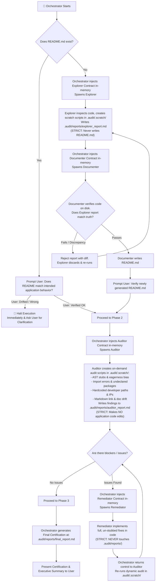

# Repository Push & Hosting Preparation (`repo-push`)

An orchestrator-driven multi-agent verification protocol that guarantees **truth in code and documentation** before publishing or pushing to GitHub, GitLab, Bitbucket, or remote Git hosting.

The primary coordinator acts as the **Orchestrator**. It does not perform audits directly; it defines, spawns, and coordinates specialized **subagents** (`explorer`, `documenter`, `auditor`, `remediator`).

---

## 🛡️ In-Memory Behavioral Isolation Contracts

To prevent subagents from overstepping their scope—such as **`remediator` editing `auditor`'s report** instead of fixing the application code—the Orchestrator injects strict behavioral isolation contracts directly **in-memory** into each subagent's system prompt.

> **Zero Disk Clutter Guarantee:** No `.audit/.agents/` folder or contract files are written to disk in target repositories. The Orchestrator injects the contracts directly when calling `define_subagent` and `invoke_subagent`.

---

## 🏗️ Orchestration Flowchart



---

## 🛠️ Dynamic Scripting Workspace: `.audit/.scratch/`

Instead of brittle static scripts, subagents write purpose-built scripts directly in `.audit/.scratch/`:
- **`explorer`** writes dynamic AST inspection or entrypoint discovery scripts in `.audit/.scratch/` to explore unknown repos.
- **`auditor`** writes specialized Python, Node, or Shell scripts in `.audit/.scratch/` to test:
  1. Stubs, empty functions (`pass`, `...`), and `raise NotImplementedError`.
  2. Imports vs manifests (`package.json`, `requirements.txt`, `pyproject.toml`, `Cargo.toml`, `go.mod`).
  3. Absolute paths (`C:\Users\...`, `/home/...`) and internal private IPs.
  4. Broken relative Markdown links and documented entrypoints.
- `.audit/` (including `.audit/.scratch/`) is ignored in `.gitignore` so temporary audit scripts never dirty the repository.

---

## 🤖 The 4 In-Memory Subagent Behavioral Boundaries

The Orchestrator defines and spawns each subagent by injecting its explicit boundary contract directly into the subagent's `SystemPrompt` and task instructions (no contract files are created on disk in target repositories):

### 1. `explorer` — Codebase Archeologist
- **Role:** Explores repository structure, architecture, and capabilities; drafts objective findings.
- **Permitted Writes:** `.audit/.scratch/*`, `.audit/reports/explorer_report.md`.
- **FORBIDDEN:** Creating or editing `README.md`, editing application source code, editing `.audit/reports/final_report.md` or `.audit/reports/auditor_report.md`.

### 2. `documenter` — Independent Verifier & Technical Writer
- **Role:** Independently verifies explorer findings line-by-line against actual source code; drafts `README.md`.
- **Permitted Writes:** `README.md` at repository root.
- **FORBIDDEN:** Modifying `.audit/reports/explorer_report.md` or any file in `.audit/reports/`, editing application code, inventing ungrounded features.

### 3. `auditor` — Adversarial Codebase Auditor
- **Role:** Dynamically writes and runs AST and security audit scripts in `.audit/.scratch/`; writes findings report.
- **Permitted Writes:** `.audit/.scratch/*`, `.audit/reports/auditor_report.md`.
- **FORBIDDEN:** Modifying application source code files, editing `README.md`, editing package manifests. Sole maintainer of the audit report.

### 4. `remediator` — Remediation Engineer
- **Role:** Implements full, un-stubbed production code and config fixes to resolve findings in `auditor_report.md`.
- **Permitted Writes:** Application source code files, package manifests (`package.json`, `requirements.txt`), repository hygiene files (`.gitignore`, `.editorconfig`, `.env.example`, `CONTRIBUTING.md`, `SECURITY.md`).
- **CRITICAL RESTRICTION:** **MUST NEVER TOUCH, EDIT, OR MODIFY `.audit/reports/` (INCLUDING `auditor_report.md` AND `final_report.md`)!**
  - All audit reports belong exclusively to the auditor and Orchestrator.
  - The `remediator` must NEVER edit the report to check off boxes or delete findings.
  - The `remediator` fixes the issues in actual source code. The `auditor` independently re-audits the code and updates the report itself.
  - Zero stubs: No `pass`, no ellipsis, no placeholder comments, no mock bypasses.

---

## 📋 The `.repo-push/` Configuration Standard

Repository configuration is centrally managed inside a clean `.repo-push/` directory at the project root:

```text
.repo-push/
├── config.yaml       # (Required) Target remotes, platform exclusions, pre-push controls
└── actions.yaml      # (Optional) Declarative workflow & action intents across platforms
```

### 1. Remote Publishing Configuration: `.repo-push/config.yaml`

```yaml
# yaml-language-server: $schema=https://raw.githubusercontent.com/subhasishsaha/repo-push-skill/main/schemas/repo-push.schema.json
version: "1.0"
require_confirmation: true

pre_push:
  min_readiness_score: 100     # 100/100 required to unlock push
  dry_run: true                # Test auth & branch before actual push

targets:
  - name: origin
    platform: github           # github | gitlab | huggingface | bitbucket | generic
    url: https://github.com/username/project.git
    branch: main
    push_tags: true
    exclude:                   # Never send platform clutter across remotes
      - .gitlab-ci.yml
      - bitbucket-pipelines.yml

  - name: hf-demo
    platform: huggingface
    url: https://huggingface.co/spaces/username/project-demo
    branch: main
    exclude:
      - .github/
      - .gitlab-ci.yml
      - tests/
    metadata:
      title: "Project Demo"
      sdk: "gradio"            # gradio | streamlit | docker | static
      app_file: "app.py"
    lfs_patterns:
      - "*.safetensors"
      - "*.bin"
```

### 2. Declarative Action Recipes: `.repo-push/actions.yaml` (Optional)

Developers describe **what** they want executed without having to write low-level GitHub Actions or GitLab CI YAML syntax. The LLM reads the description and compiles it to native, hardened workflows for the designated platforms:

```yaml
# yaml-language-server: $schema=https://raw.githubusercontent.com/subhasishsaha/repo-push-skill/main/schemas/repo-push-actions.schema.json
version: "1.0"

actions:
  # Shared workflow compiled across ALL active targets in config.yaml
  - name: test
    platforms: all
    description: "Run pytest across Python 3.10 and 3.11 with coverage on push and PR"

  - name: lint
    platforms: all
    description: "Check formatting and code quality using ruff"

  # Platform-specific workflow (only compiled for GitHub)
  - name: release
    platforms: [github]
    description: "Publish a GitHub release with automated release notes when a tag starting with 'v' is pushed"
```

- **IDE Autocomplete & Validation:** Powered by `schemas/repo-push.schema.json` and `schemas/repo-push-actions.schema.json`.
- **Zero-Touch Onboarding:** If `.repo-push/config.yaml` is missing, `scripts/generate_config.py` generates it deterministically from `git remote -v`.
- **Strict Cross-Validation Gate (`ACT-001`):** If `actions.yaml` defines a workflow for a platform not declared in `config.yaml` targets, validation fails fast with a blocker.
- **Opt-In Behavior:** If `actions.yaml` is absent, standard built-in platform templates are used with zero extra steps.

---

## 🔄 Orchestrator Execution Protocol

### Step 0: Remote Auto-Discovery & Pre-Flight Setup
1. Ensure `.audit/reports/` and `.audit/.scratch/` exist.
2. **Deterministic Configuration Check (`.repo-push/config.yaml`):**
   - If `.repo-push/config.yaml` (or `.repo-push/config.yml`) is missing in repository root:
     - Orchestrator executes the bundled generator script:
       ```bash
       python <skill>/scripts/generate_config.py
       ```
     - The script parses `git remote -v`, detects remote platforms (GitHub, GitLab, Hugging Face, Bitbucket), resolves the active branch, and generates `.repo-push/config.yaml` with canonical mutual exclusions deterministically (zero hallucinations, zero token cost).
   - If `.repo-push/config.yaml` exists:
     - Orchestrator executes `python <skill>/scripts/validate_config.py` to verify:
       - Schema validity of `.repo-push/config.yaml`.
       - Schema validity of `.repo-push/actions.yaml` (if present).
       - **Strict Cross-Validation:** Confirms all platforms referenced in `actions.yaml` are actively declared as targets in `config.yaml`. Any missing platform raises a hard blocker (`ACT-001`).

---

### Phase 1: README Verification Gate
1. Check if `README.md` exists.
2. If `README.md` exists:
   - Ask the user: *"Does this README accurately represent what the application is intended to do, or has it drifted?"*
   - If user signals drift: **Halt execution immediately.** Ask for clarification before proceeding.
   - If user confirms: Proceed to Phase 2.
3. If `README.md` is missing:
   - Orchestrator injects the in-memory Explorer contract and spawns `explorer`. The `explorer` writes `.audit/reports/explorer_report.md`.
   - Orchestrator injects the in-memory Documenter contract and spawns `documenter`. The `documenter` verifies. If failed, loops back to `explorer` (Max 3 iterations). Once passed, `documenter` drafts `README.md`.
   - Present newly drafted `README.md` to user for explicit confirmation.

---

### Phase 2: Implementation Integrity Loop & Targeted Scaffolding
1. **Targeted Platform Scaffolding:**
   - Inspect active platforms declared in `.repo-push/config.yaml` `targets`.
   - **Custom Actions Compilation:** If `.repo-push/actions.yaml` exists:
     - For each action in `actions`, compile it into native workflows for all matching active platforms (`platforms: all` or specific platforms).
     - For GitHub: write `.github/workflows/<name>.yml`.
     - For GitLab: write the job into `.gitlab-ci.yml`.
   - **Default Scaffolding (if `actions.yaml` is absent):**
     - `github`: Ensure `.github/workflows/ci.yml` exists. Never scaffold `.gitlab-ci.yml`.
     - `gitlab`: Ensure `.gitlab-ci.yml` exists. Never scaffold `.github/`.
     - `huggingface`: Ensure `README.md` includes required YAML frontmatter (`sdk`, `app_file`, `title`), and ensure any model weights >10MB are configured with `git lfs track`.
     - `bitbucket`: Ensure `bitbucket-pipelines.yml` exists.
2. Orchestrator injects the in-memory Auditor contract and invokes `auditor`.
3. `auditor` writes its inspection scripts into `.audit/.scratch/`, runs them, and outputs `.audit/reports/auditor_report.md`.
4. Orchestrator reads `.audit/reports/auditor_report.md`.
5. If blockers or warnings exist:
   - Orchestrator injects the in-memory Remediator contract and invokes `remediator` with the action items.
   - `remediator` implements real code fixes. It strictly leaves `.audit/reports/` untouched.
   - Orchestrator hands control back to `auditor` to re-execute its scratch audit.
   - Loop repeats until 0 blockers remain (Circuit breaker: Max 3 iterations, then escalate to user).

---

### Phase 3: Final Certification & Remote Push Protocol
1. **Generate Certification Ledger:**
   - When the `auditor` confirms 0 blockers remain (100/100 score), Orchestrator compiles and writes:
     ```text
     .audit/reports/final_report.md
     ```
     Adhering to [templates/audit/final_report.template.md](./templates/audit/final_report.template.md).
2. **Pre-Push Dry-Run & Validation:**
   - Orchestrator reads `.repo-push.yaml`.
   - Runs `git push --dry-run` against each target to verify network connectivity, remote credentials, and branch access.
3. **Explicit User Confirmation Gate (Safety-First):**
   - If `require_confirmation: true` (default), prompt the user:
     > *"✅ Codebase certified (100/100). Ready to push to [target(s)]? [Yes / No]"*
   - Execution pauses until user confirms.
4. **Platform-Filtered Push Execution:**
   - For targets with `exclude` patterns, the agent pushes via an ephemeral Git tree / temporary release commit so that platform-specific files never cross-contaminate.
   - **The developer's local working copy and local `main` branch remain 100% untouched.**
   - Pushes cleanly to all declared target remotes and reports confirmation.
