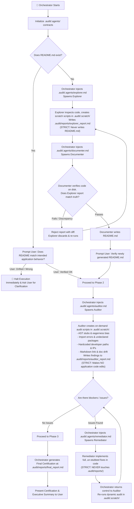

# Repository Push & Hosting Preparation (`repo-push`)

An orchestrator-driven multi-agent verification protocol that guarantees **truth in code and documentation** before publishing or pushing to GitHub, GitLab, Bitbucket, or remote Git hosting.

The primary coordinator acts as the **Orchestrator**. It does not perform audits directly; it defines, spawns, and coordinates specialized **subagents** (`explorer`, `documenter`, `auditor`, `remediator`).

---

## 🛡️ Behavioral Isolation & File Boundary Contracts (`.audit/.agents/`)

To prevent subagents from overstepping their scope—such as **`remediator` editing `auditor`'s report** instead of fixing the application code—the Orchestrator enforces strict behavioral contracts stored in:
```text
.audit/.agents/
├── explorer.md      # Explorer contract (write only .audit/reports/explorer_report.md & .audit/.scratch/)
├── documenter.md    # Documenter contract (write only README.md; never touch .audit/reports/)
├── auditor.md       # Auditor contract (write only .audit/.scratch/ & .audit/reports/auditor_report.md)
└── remediator.md    # Remediation contract (write ONLY application code; NEVER touch .audit/reports/)
```

The Orchestrator injects the exact behavioral contract from `.audit/.agents/<role>.md` into each subagent's system prompt and task instructions.

---

## 🏗️ Orchestration Flowchart



---

## 🛠️ Dynamic Scripting Workspace: `.audit/.scratch/`

Instead of brittle static scripts, subagents write purpose-built scripts directly in `.audit/.scratch/`:
- **`explorer`** writes dynamic AST inspection or entrypoint discovery scripts in `.audit/.scratch/` to explore unknown repos.
- **`auditor`** writes specialized Python, Node, or Shell scripts in `.audit/.scratch/` to test:
  1. Stubs, empty functions (`pass`, `...`), and `raise NotImplementedError`.
  2. Imports vs manifests (`package.json`, `requirements.txt`, `pyproject.toml`, `Cargo.toml`, `go.mod`).
  3. Absolute paths (`C:\Users\...`, `/home/...`) and internal private IPs.
  4. Broken relative Markdown links and documented entrypoints.
- `.audit/` (including `.audit/.scratch/` and `.audit/.agents/`) is ignored in `.gitignore` so temporary audit scripts never dirty the repository.

---

## 🤖 The 4 Subagent Behavioral Boundaries

The Orchestrator must define and spawn each subagent with its explicit contract from `.audit/.agents/`:

### 1. `explorer` — Codebase Archeologist
- **Contract File:** `.audit/.agents/explorer.md`
- **Permitted Writes:** `.audit/.scratch/*`, `.audit/reports/explorer_report.md`.
- **FORBIDDEN:** Creating or editing `README.md`, editing application source code, editing `.audit/reports/final_report.md` or `.audit/reports/auditor_report.md`.

### 2. `documenter` — Independent Verifier & Technical Writer
- **Contract File:** `.audit/.agents/documenter.md`
- **Permitted Writes:** `README.md` at repository root.
- **FORBIDDEN:** Modifying `.audit/reports/explorer_report.md` or any file in `.audit/reports/`, editing application code, inventing ungrounded features.

### 3. `auditor` — Adversarial Codebase Auditor
- **Contract File:** `.audit/.agents/auditor.md`
- **Permitted Writes:** `.audit/.scratch/*`, `.audit/reports/auditor_report.md`.
- **FORBIDDEN:** Modifying application source code files, editing `README.md`, editing package manifests. Sole maintainer of the audit report.

### 4. `remediator` — Remediation Engineer
- **Contract File:** `.audit/.agents/remediator.md`
- **Permitted Writes:** Application source code files, package manifests (`package.json`, `requirements.txt`), repository hygiene files (`.gitignore`, `.editorconfig`, `.env.example`, `CONTRIBUTING.md`, `SECURITY.md`).
- **CRITICAL RESTRICTION:** **MUST NEVER TOUCH, EDIT, OR MODIFY `.audit/reports/` (INCLUDING `auditor_report.md` AND `final_report.md`)!**
  - All audit reports belong exclusively to the auditor and Orchestrator.
  - The `remediator` must NEVER edit the report to check off boxes or delete findings.
  - The `remediator` fixes the issues in actual source code. The `auditor` independently re-audits the code and updates the report itself.
  - Zero stubs: No `pass`, no ellipsis, no placeholder comments, no mock bypasses.

---

## 🔄 Orchestrator Execution Protocol

### Step 0: Behavioral Setup
Ensure `.audit/.agents/` exists and contains the 4 behavioral contracts (bootstrapped from `templates/agents/` if needed).

### Phase 1: README Verification Gate
1. Check if `README.md` exists.
2. If `README.md` exists:
   - Ask the user: *"Does this README accurately represent what the application is intended to do, or has it drifted?"*
   - If user signals drift: **Halt execution immediately.** Ask for clarification before proceeding.
   - If user confirms: Proceed to Phase 2.
3. If `README.md` is missing:
   - Orchestrator injects `.audit/.agents/explorer.md` and spawns `explorer`. The `explorer` writes `.audit/reports/explorer_report.md`.
   - Orchestrator injects `.audit/.agents/documenter.md` and spawns `documenter`. The `documenter` verifies. If failed, loops back to `explorer` (Max 3 iterations). Once passed, `documenter` drafts `README.md`.
   - Present newly drafted `README.md` to user for explicit confirmation.

### Phase 2: Implementation Integrity Loop
1. Orchestrator ensures directory `.audit/.scratch/` exists.
2. Orchestrator injects `.audit/.agents/auditor.md` and invokes `auditor`.
3. `auditor` writes its inspection scripts into `.audit/.scratch/`, runs them, and outputs `.audit/reports/auditor_report.md`.
4. Orchestrator reads `.audit/reports/auditor_report.md`.
5. If blockers or warnings exist:
   - Orchestrator injects `.audit/.agents/remediator.md` and invokes `remediator` with the action items.
   - `remediator` implements real code fixes. It strictly leaves `.audit/reports/` untouched.
   - Orchestrator hands control back to `auditor` to re-execute its scratch audit.
   - Loop repeats until 0 blockers remain (Circuit breaker: Max 3 iterations, then escalate to user).

### Phase 3: Final Certification & Ledger
1. When the `auditor` confirms 0 blockers remain, Orchestrator compiles and writes:
   ```text
   .audit/reports/final_report.md
   ```
   Adhering to [templates/audit/final_report.template.md](./templates/audit/final_report.template.md).
2. Orchestrator verifies `git status`.
3. Orchestrator presents the final certification summary to the user.
